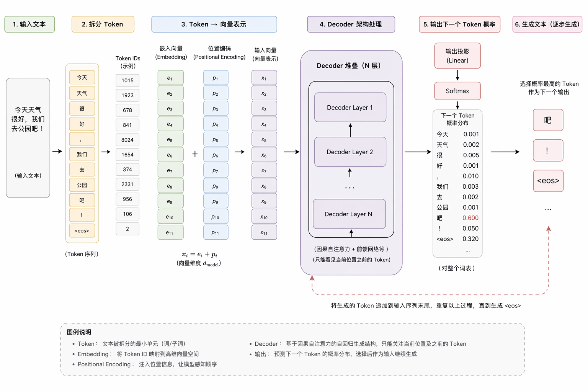

# Transformer 架构

## Transformer 架构三种形态
- **Encoder-only 纯编码器**：靠双向注意力，同时看上下文前后内容，只做”理解”不做生成，适合文本分类、嵌入向量、重排序这类任务。
- 🌟**Decoder-only 纯解码器**：靠单向掩码注意力，只能看已生成的上文，专门做“续写、生成”，是当前对话大模型的绝对主流。
- **Encoder-Decoder 组合框架**：编码器理解输入，解码器生成输入，适合翻译、摘要这类“序列到序列”转换任务。

> 双向注意力是直接看到全文（上文+答案），适合理解任务，学不会规律。单向注意力是只能根据上文推断，练习多了就会规律了。

一句话总结：Encoder 负责理解与检索，Decoder 负责生成与决策，二者协同，构成 Agent 的完整能力。

理解 -> 检索 -> 增强 -> 生成 -> 记忆 -> 再次循环

## 流程
### 输入
原始文本 -> 分词 Tokenizer -> Token 和 ID 映射 -> Embedding 查表 -> 加上位置编码

### 生成
自回归生成 Autoregressive Generation：根据已生成的内容来预测下一个字
- 隐藏状态：模型结合上文、注意力权重后，最终形成的“上下文理解结果”。它本身不是词，也不是概率，只是模型内部的高维“语义向量”。
- 输出投影：把“想法”翻译成“每个词的候选得分”。
- Softmax 概率换算：把“得分”变成“下一个词的概率”。